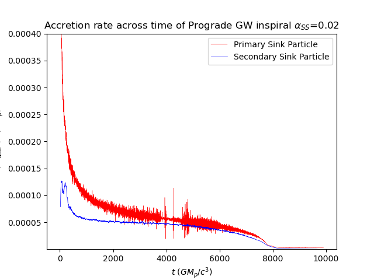
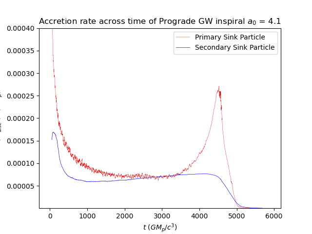
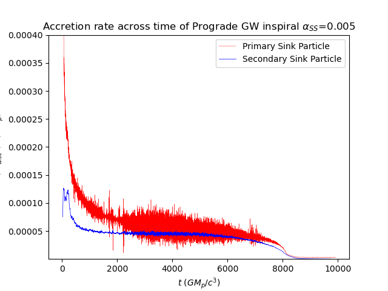

# Week 6 Summary 
Been running the $H/R=0.005$ for more than a week and not even halfway through the simulation. Ran a sim for reducing time, it worked
but the sim is too far gone that there would be no point cancelling. 

## Talking about changing  viscosity  
### Artificial Viscosity $\alpha$
When increasing alpha. This was not to show that the snowplough was not possible, I increasing the disc viscosity was sure to decrease the chance of pile
up within the accretion disc. This is due to the equations:  
$\nu_{AV} \approx \frac{1}{10} \alpha_{AV} c_s h$  
This paired with the SS viscosity: $\nu = \alpha_{SS} c_s H$  
These two equations when equating them together gives the viscosity parameter of the disc given below:  
$\alpha_{disc} \approx \frac{1}{10} \alpha_{AV} \frac{<h>}{H}$  
So lowering the SS-alpha value returns a smaller viscosity within the disc. Therefore:  
* Lower Viscous timescales
* Slower angular momentum transport
* Disc piles up more easily, therefore snowplough more likely.
But if the smoothing length, $h$ is large, $\alpha_{disc}$ might not change much.

### Quadratic viscosity term $\beta_{AV}$  
* Handle string shocks
* Prevent particle penetration in high Mach number shocks $M=\frac{v}{c_s}$
$\beta$ is equal to 2 if there is shock in the simulation and 0 if modelling only viscosity
Increasing $\beta$ does:
* More shock damping
* More compression dissipation
* Can artificially supress density waves

## Data  
The following is data found in the past three days before the meeting on Friday.  

### $\alpha_{SS} = 0.02$  
This is the first data found. It was done to have more data for my thesis, not expecting any results. Here is the accretion rate across time.  
  
This shows that there is no visible snowplough effect. This makes sense, as $\beta=2$ the snowplough effect is now not likely as well 
as increasing the artificial viscosity, reducing the chance of pile up.  

### $a_0$ deceased  
This sim was using $\beta$ as 0, in order to replicate Cerioli et al. snowplough effect again, however shaving off 4000 time code units.  
Here were the results:  
  
This is the accretion rate with a decreased time. As we can see, it worked. This will decrease the running time significantly. I would want
 to do this with the H/R sim, however, the sim has already went past what I simulated from, so there would be no point.  
 From now on I will simulate from this point. $a_0=4.175$ and $R_{out} = 3.604$ I found these numbers using the Peters 1964 separation rate wrt time.  
 (Data for $\alpha_{SS}=0.005$ still has 10000 time code units)  
 
### $\alpha_{SS}=0.005$
Data found with with 500000 particles. No apparent snowplough. Normal trend compared to the 0.01 and 0.02, just more noise. Here is the graph:  
  
No snowplough effect. My scaling length is quite large and therefore maybe that's why this didn't work.  
* Going to run a simulation with the same parameters, except the resolution is now increased to 1 million.
* Still waiting for the sim of a normal parameter, except now with the $R_{out}$ is equal to its correct Schwarzschild radius.
