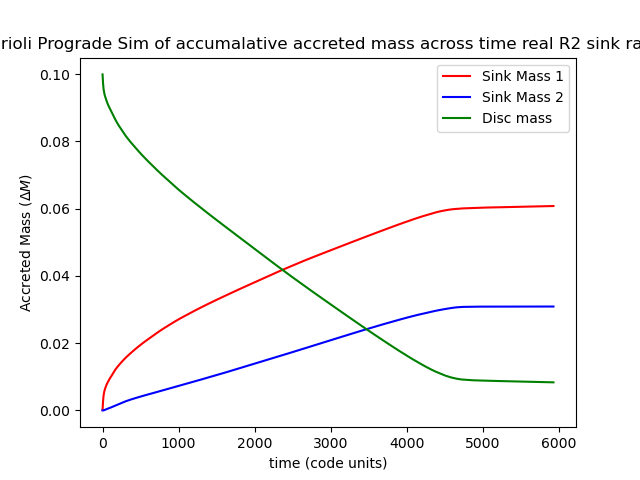
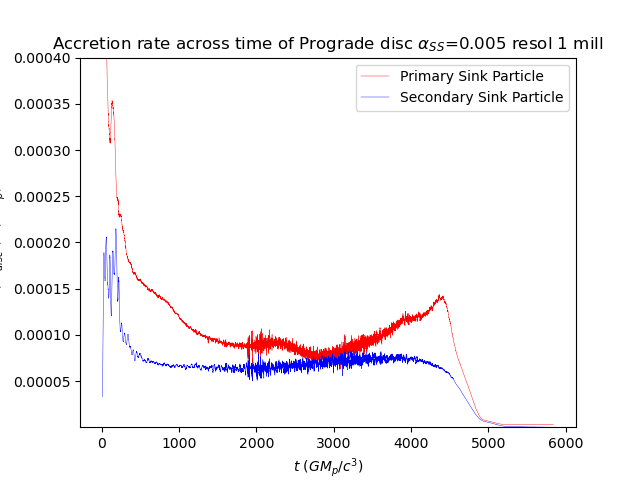
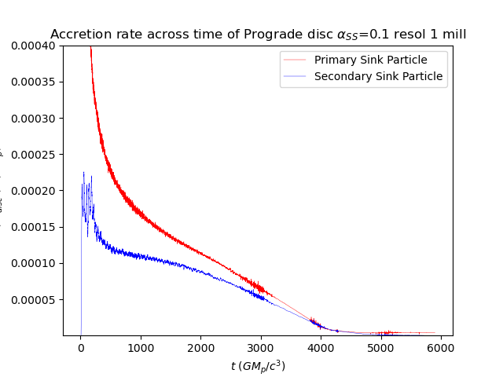

# Week 7 Summary

Simulation with $5*10^{5}$ particles still running. Been 2 Weeks and at 480 images out of 993. Is it worth it to cancel the simulation and think how to make it run faster or keep running it?  

## $R_{acc,2}$ real relative to mass ratio results  
Ran a sim seeing what would be the case if $R_{acc,2}$ was equal to its real size rather than 100x more than its supposed to be as it has been in all simulations. Sim had a lot of noise in this compared to other simulations which is weird. To reduce noise, I have been using every 10th datastep, should that be reduced and 
look again at all data? However, with this data I have had more noise than ever before. I accidentally rewrote over when N=10 in my graph with when N=100, however, still a lot of noise where you can't notice a trend. Unsure why this happened. Here are both graphs:

  
This is the data for when N=100. Where N is the number of datapoints skipped before plotting. There is not much when it comes to seeing an accretion rate trend for the primary black hole.  
The trend can be seen when I consider even less datapoints. Should I be doing this though? Here are the results nonetheless:  
  
The trend looks better here. However, as less data points not entirely real. Secondary data points did not change and I don't believe the accretion rate of the secondary ever becomes greater than the primary. Thsi can be shown with the total mass accreted graph.  
Here is the graph for that:  
  
There is no point in this data where the gradient of the secondary is greater than the primary. As this data considers every data point, we can assume this is real and the trend is only correct for initial time points. However, we are more interested in the end so how do we fix? Though it is still obvious that there is no apparent snowplough effect in this simulation.  

Still currently simulating $\alpha=0.005$ for when the resolution is 1 million, however results will be done soon. 10/03/2026

## Simulation results for all recent sims finished this week

### $\alpha_{SS}=0.005$ with resolution of 1 million  

This data took a week to run, however once finshed it showed a clear (however small) snowplough effect. This is die to the artificial viscosity equations being dependent on the smoothing length. Here is the results with less noise.  
  
This shows a snowplough effect. However, there is no point where the accretion rate of the secondary is greater than that of the primary, which is interesting.  
With this effect shown, sims need to be ran to see what it looks like with the alpha increasing to 0.1. As well as also reducing the radius to see how it fits with lower radii.  

### $\alpha_{SS}=0.1$ with resolution of 1 million  

This only took a night to run but it didn't show anything useful. This was only done for the story of the thesis.  
  
This shows that the snowplough effect is not in effect at all here. In fact, no material is pushed towards the primary and neither SMBHs accrete matter after the initial spike, which should not be considered in data as that is only representing the simulation starting. All matter is pushed away by the secondary via horseshoe orbits expressed in Cerioli et al. (2016) paper.  

Currently waiting for 4 other simulations.  
* Running $\alpha_{SS}=0.005$ with a resolution of 2 million particles in the disc. This hopefully means an even sharper snowplough effect.
* Running a simulation for 1 million particles and alpha being 0.005 again, except varying the radius of the secondary by a factor of 10 each time. When $R_{acc,S}=0.02$ relative to the primary will be done by next week, when $R_{acc,S}=0.002$ relative to the primary will not be done for a while.

## Plans for the Weekend  
* Read about the common $\alpha_{SS}$ within a disc and make a comment on this in your thesis (unsure of what section)
* Look at common aspect ratios as well
* Write and finish your numerical methods section of the write up of the thesis.
