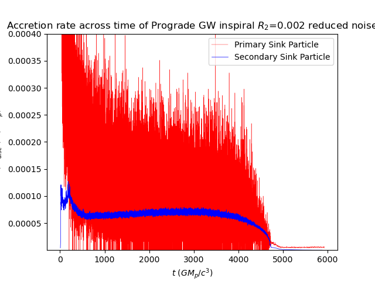
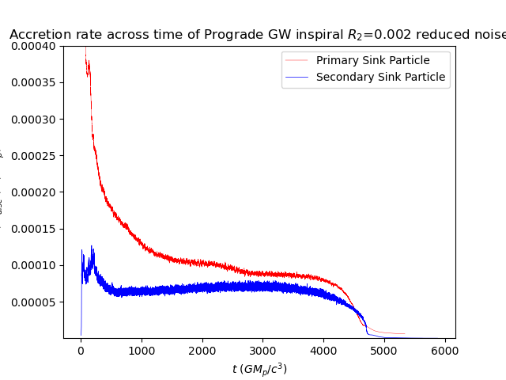

# Week 7 Summary

Simulation with $5*10^{5}$ particles still running. Been 2 Weeks and at 480 images out of 993. Is it worth it to cancel the simulation and think how to make it run faster or keep running it?  

## $R_{acc,2}$ real relative to mass ratio results  
Ran a sim seeing what would be the case if $R_{acc,2}$ was equal to its real size rather than 100x more than its supposed to be as it has been in all simulations. Sim had a lot of noise in this compared to other simulations which is weird. To reduce noise, I have been using every 10th datastep, should that be reduced and 
look again at all data? However, with this data I have had more noise than ever before. I accidentally rewrote over when N=10 in my graph with when N=100, however, still a lot of noise where you can't notice a trend. Unsure why this happened. Here are both graphs:

  
This is the data for when N=100. Where N is the number of datapoints skipped before plotting. There is not much when it comes to seeing an accretion rate trend for the primary black hole.  
The trend can be seen when I consider even less datapoints. Should I be doing this though? Here are the results nonetheless:  
  
The trend looks better here. However, as less data points not entirely real. Secondary data points did not change and I don't believe the accretion rate of the secondary ever becomes greater than the primary. Thsi can be shown with the total mass accreted graph.
