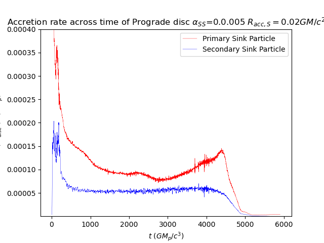

# Week 8 Summary  
All data results from sims ran last week shall be put here.  

## $\alpha_{SS}=0.005$ and $R_{acc,S}=0.02GM/c^2  
This data was done to show the limits of this theory and nothing more, however it ended up helping my research even more.  

  
This showed that there is also a snowplough effect seen accreting onto the primary during the merger. It was unexpected that the 
data would actually be inclined towards being correct. Why did this work? Would it work with Cerioli et al. sims?  

Still waiting for other sims 16/03/2026
