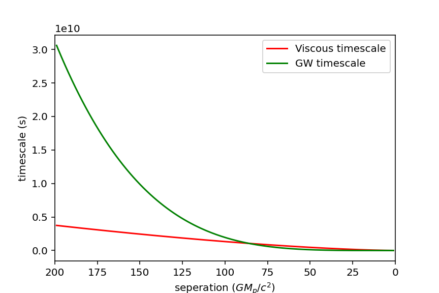
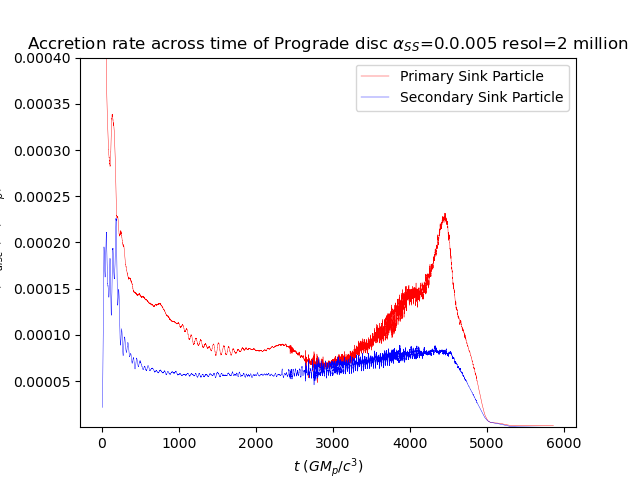
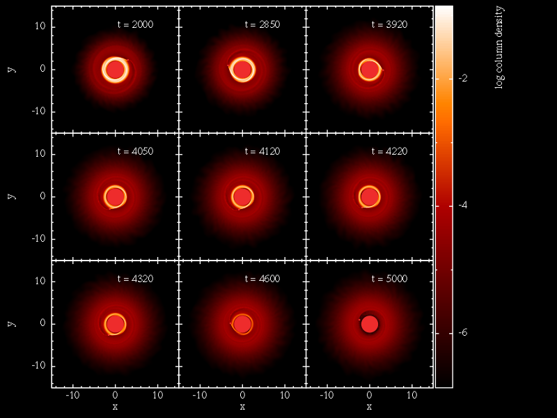

# Week 8 Summary  
All data results from sims ran last week shall be put here.  

## $\alpha_{SS}=0.005$ and $R_{acc,S}=0.02GM/c^2$  
This data was done to show the limits of this theory and nothing more, however it ended up helping my research even more.  

  
This showed that there is also a snowplough effect seen accreting onto the primary during the merger. It was unexpected that the 
data would actually be inclined towards being correct. Why did this work? Would it work with Cerioli et al. sims?  

Still waiting for other sims 16/03/2026

## Decoupling Separation when $\alpha_{SS}=0.005$  
Having the decoupling sep for when $\alpha_{SS}$ was equal to 0.01 was good for explaining what the value represents. When trying to find the decoupling sep when $\alpha_{SS}=0.005$ the timescales have a weirder relationship. Here is the graph:  
  
Made a better graph for all. However, the decoupling separation I have calculated differs to Cerioli et al. (2016). I have a value of $65GM/c^2$ and the equation used in the Cerioli et al. paper was $~25GM/c^2$. This is a big difference.  
Cerioli derived their expression from a self gravitating disc model and H/R is not fixed. They also used a scaling mass ratio which is used in GW physics. So I am off their value by roughly a factor of 2.  

## Resolution of 2 million when $\alpha_{SS}=0.005$  
This just shows that there is a higher snowplough effect when there are more particles within the disc and the smoothing length is less than the one with less particles.  
  
Higher spike of accretion.  

### 19/03/2026  
Today tried looking at the sigma against radius graph for my $\alpha_{SS}=0.005$. It looked nothing like the graph produced by Cerioli et al. (2016). Peak shifts to the left, good. Not the highest peak just before merger, bad. Not uploading the graph onto git as the graph isn't up to good standard. Needs to be improved before putting it here.  

#### Why did I get these results  
Obviously uncertain and need to ask my supervisor once he is free. However some theories:  
* Disc cannot respond fast enough and material is just pushed onto the primary and never settles onto the disc.
* Unsure of other reasons and really neeed a meeting
* It is due to my secondary not accreting as much material as the primary. It is simply pushing the material onto the primary.

## Resolution of 1 million with $\alpha_{SS}=0.005$ 

### 20/03/2026  
Trying to have a good graph to show the surface density across radius. I will do that but first here are the snapshots of the sim.  
  
This is good I like this. Unsure of how to remove the black background behind the column density but it's fine.  

