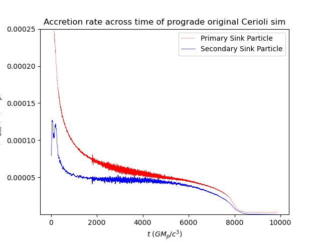
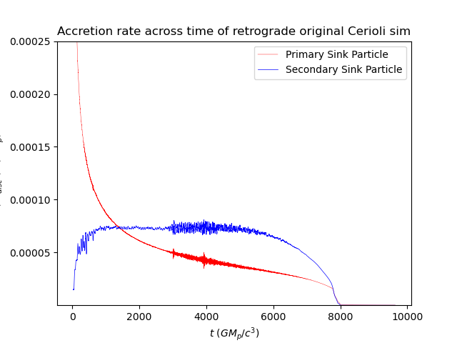

# Week 3 Summary

## Decoupling Separation
Firstly, changed parameters on parameter identification python file to show what my viscous and GW timescales are for the Cerioli simulation.
Then with the knowledge of what my intercept would look like between the timescales, I plotted a graph for timescales against separation, a. Made a np.array of values going up to 200 and then plotted. The graph looks like this: 

## Reducing Noise

The graphs produced last week with the simulations may have had the data looking wrong, but it still needed to be made cleaner, just so it looks good when the data I want to be produced is made. Reworked my code to have much more timesteps between accreted mass diff. Made the graph much less noisy. 

### Prograde Graph

This shows a much better relation than in previous weeks. An issue with my code was apparent and it was due to returning the intial value before normalising for the secondary sink. However normalising the primary. This still isn't the data that we are looking for as we see no apparent "snowplough effect". Cerioli et al. stated that the this effect should occur for all number of particles so my parameter for that should not have changed that.

### Retrograde Graph

  
 This is the same graph as the previous week, except now with a normalised secondary sink plot. The plot now has an apparent intersect, where the secondary accretion rate becomes larger than the primary. Look at other data later, however need to replicate this result when the prograde instance actually works.

## Next Week
Before meeting:  
Rerun sim and with a different disc mass parameter and also a different beta parameter (disc viscosity).  
Plot this new data into the accretion rate functions already made.  
Work on Surface density code and see if need to ask Chris about equations.
