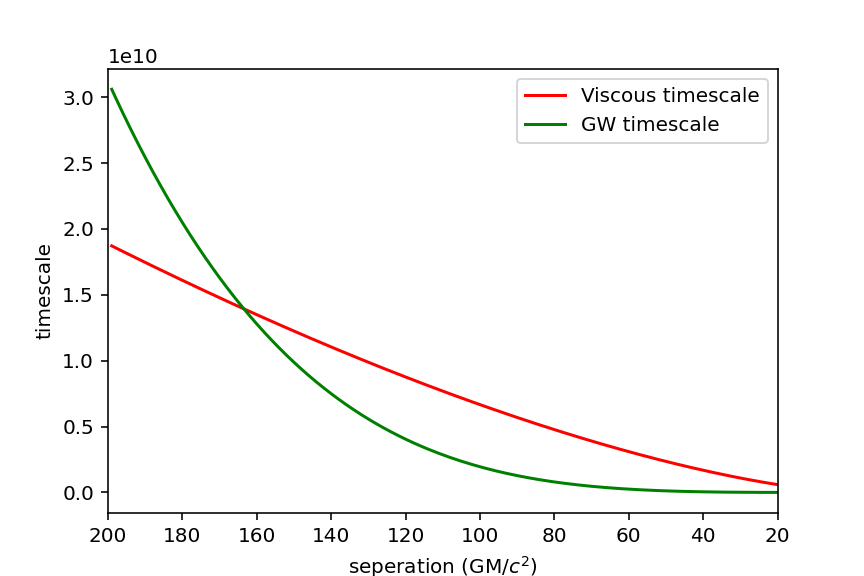

# Week 3 Summary

## Decoupling Separation
Firstly, changed parameters on parameter identification python file to show what my viscous and GW timescales are for the Cerioli simulation.
Then with the knowledge of what my intercept would look like between the timescales, I plotted a graph for timescales against separation, a. Made a np.array of values going up to 200 and then plotted. The graph looks like this: 

## Reducing Noise

The graphs produced last week with the simulations may have had the data looking wrong, but it still needed to be made cleaner, just so it looks good when the data I want to be produced is made. Reworked my code to have much more timesteps between accreted mass diff. Made the graph much less noisy. 

### Prograde Graph

![Accretion rate over time. Much less noise in these pngs and limits also changed](../Week3/Cerioli_sim/

### Retrograde Graph

 ![Accretion rate over time for retrograde disc. Much less noise in png now from previous and limits changed](../Week3/Retrograde_Cerioli_sim/
