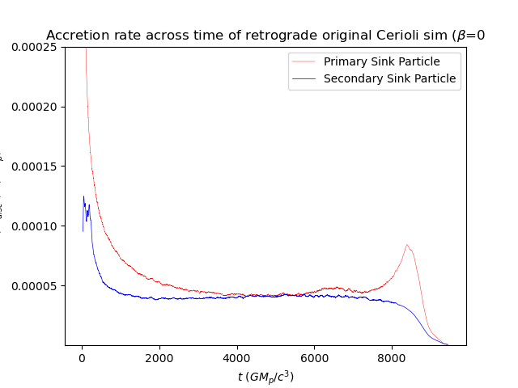
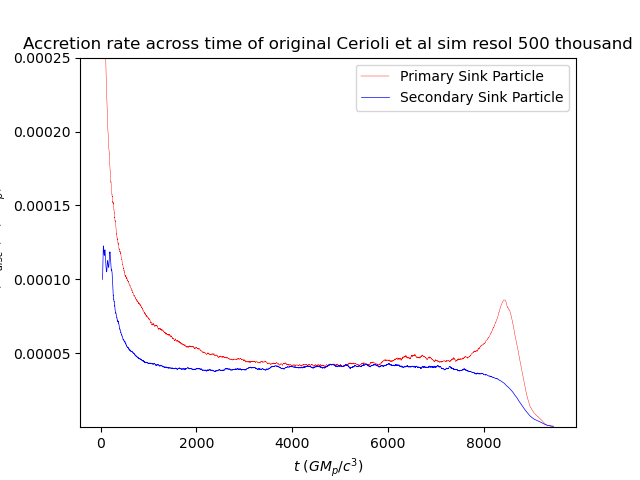
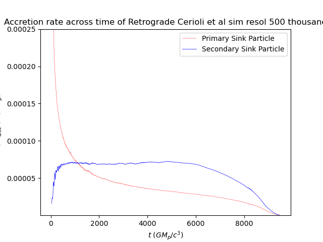
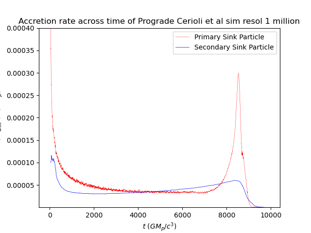
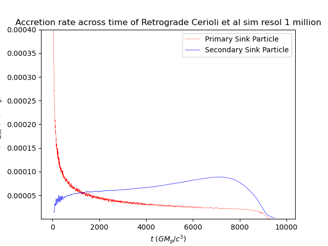

# Week 4 Summary  

## Retrying Cerioli (Pre meeting)
Ran simulation again with beta and disc mass changed to 0 and 1 respectively. These are the results:   

### Cumulative accreted mass
  
This shows a very similar trend to our previous result when beta was non zero (2). However there is a large spike at the end of the primary 
accreted mass gradient. This would be our snowplough effect. This becomes more apparent when we look at our accretion rate graph.  
Better graph produced on Jupyter notebook, show that one instead if interested.

### Accretion rate over time

  
This shows much better results than last time.  
Apparent snowplough effect seen at the end of the simulation. Not the exact same as Cerioli, however its on the right track.  
Cerioli used older code, which means that the artificial viscosity values change. We changed one of those parameters for this sim. 
Later this week I am going to change another as well and see the results.  
Also going to see mass percentages. How much went onto the primary, the secondary and expelled.  

## Next few Simulations 
This week I started going the same simulations, but with different resolutions to see if the snowplough effect is apparent in a higher resolution (as expected). The beta value is always removed and the $\alpha^{AV}$ is set to whatever is in the Cerioli et al. However, note to self, the $\alpha$ is never changed enough to feel like much of a difference. 

### Resolution of 500 Thousand 

#### Prograde Disc 

The correct shape is there in this simulation. It should be noted that less data points are considered in this graph as I changed my parameters in later data collections. 

   
This shows the snowplough effect.  

The percentage of mass from the disc at the last timestep is as follows:  
Primary Accreted mass: 57.0114%  
Secondary Accreted mass: 37.5922%  
Expelled mass: 5.3964%  
The expelled mass in Cerioli et al. data was an order of magnitude less than what I got. I am also missing a second peak. I feared it was because I got rid of some data points, but looking at other graphs, the second peak is still not apparent.  

#### Retrograde Disc 

  
No snowplough effect in this graph. However completely different effect. Accretion rate of the secondary is higher than the primary from the 1000 time code unit. There is no pushing of gas into the primary. The secondary goes around and only accretes the material on the outside of the disc.  
The secondary 1000 times smaller the mass and 10 times smaller radius accretes 10% more mass than the primary.  
The percantage of mass from the disc at the last timestep is as follows.  
Primary Accreted mass: 44.7582%  
Secondary Accreted mass: 55.2142%  
Expelled mass: 0.0276%  
This is much better than the prograde, having the correct order of magnitude for the expelled mass from the Cerioli et al. data 
even though it's a different process.  

### Resolution of 1 million  

#### Prograde Disc  

  
This has more datapoints considered, however not all of them as I think the trend isn't removed when removing the points and graph looks nicer. Ask Chris if I should revert them to more points.  
Spike higher in this, makes sense due to more particles in this simulation. Second peak trying to make itself apparent but 
still can't see it.  
The percantage of mass from the disc at the last timestep is as follows:  
Primary accreted mass: 57.6795%  
Secondary accreted mass: 37.3335%  
Expelled mass: 4.987%  

#### Retrograde Disc  

  
Same trend as the 500 thousand particles in the retrograde case. However slight difference. The accretion rate looks like it is slowly increasing until the sharp decrease as the disc is either completely accreted or expelled. However in the 500 thousand particle sim, the accretion rate was a constant. Mention this to Chris.  

The percentage of mass from the disc at the last timestep is as follows:  
Primary accreted mass: 39.999%  
Secondary accreted mass: 59.9797%  
Expelled mass: 0.0213%  

## Surface Density  
The surface density graphs are struggling due to my beta value being greater than my initial separation. This is because of a unit error I believe and unsure how to fix it.  
I also noticed that the mass of the circumprimary is equal to the mass of the priamry black hole in my calculations of the surface density. This is not wanted and unsure how to fix as the disc.setup won't let me change the primary mass.  

## What to talk about  
I don't know how to fix my surface density.  
I am noticing my thesis is very similar to the Lodato paper and want to do more to improve mine. What can I do to stand out?

