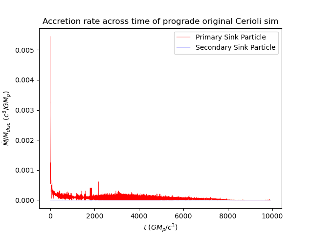
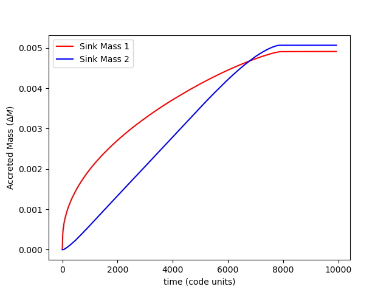
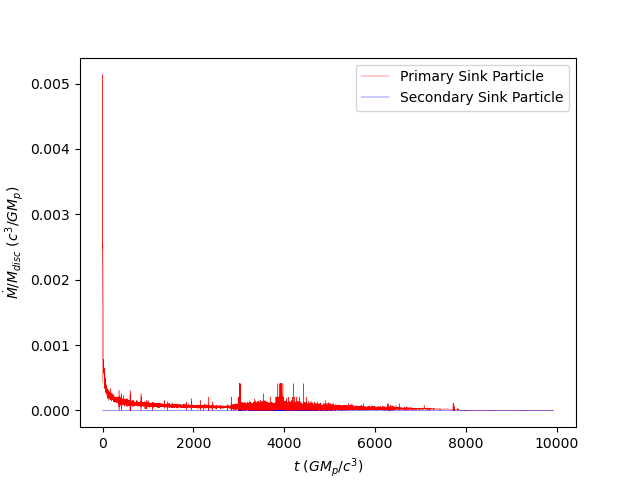

# Week 2 Summary
This week I ran a simulation with the correct timesteps. Last week, the tmax was set to be 1000 time code units, however this does not show any results worth noting.
I re-ran a Cerioli simulation repeat, however, now with a tmax as 10000 time code units. This allows for a black hole merger at the end, properly seeing the end of the binary merger.
A simulation with the exact same parameters, except with the inclination set to 180 degrees (retrograde) was also ran. 
Both simulations took around 4 days to simulate and did not get the results that was wanted/expected. 
## Prograde Cerioli
Using the disc mass as 0.01 relative to primary sink mass of 1, ran simulations using same parameters as Cerioli. THe prograde case was using the exact same parameters throughout. The entire sim took 4 days and the entire disc was either accreted or expelled. No snapshots on here, but video on OneDrive.   
Accreted mass over time shows that most if the disc was accreted, with the primary accreting the most.  
  
Other data ran also showed my accretion rate over time and this data was nothing like Cerioli's:  
  
Too much noise on this graph. To improve I will increase the number of timesteps into my code and print for week 3.  
Simulations show correctly for most part. At 8000 time code units, the disc is completely expelled or accreted, At 9930, the binary was completely merged. Very different to Cerioli's results. However, the sims did show correct physics. Resonances were very apparent in the sims (No resonances in retrograde which was good).  
## Retrograde Cerioli 
The same disc mass as the prograde case. Same parameters except now retrograde. Negligible matter was expelled in this simulation as all was accreted by secondary. This means that the accreted mass for the sec was greater than the acc mass for the primary. See figure below:  

the accreted mass without noise changes of limits changed is this:  
  
TO improve for next week.  
In meeting discuss why this happened. 
remove noise and make graphs cleaner to interpret  
Make new sims after advice on how to move forward.

